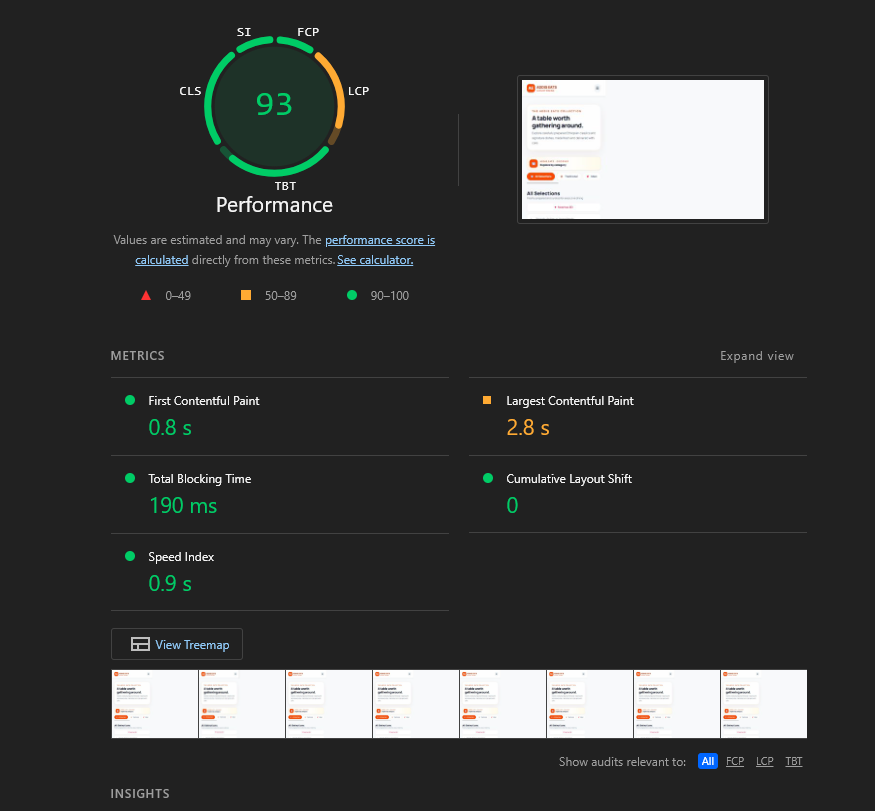
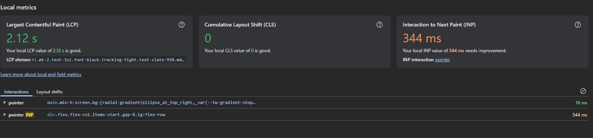
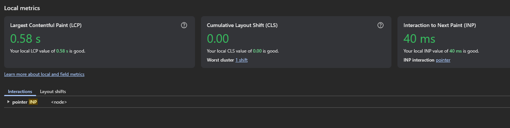
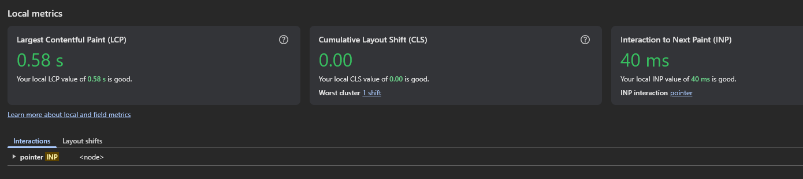
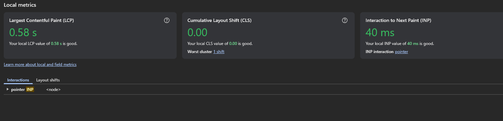
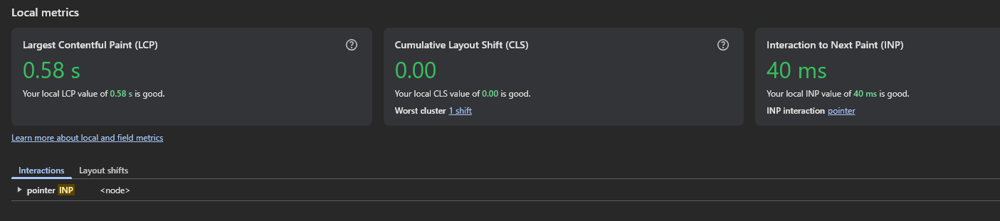
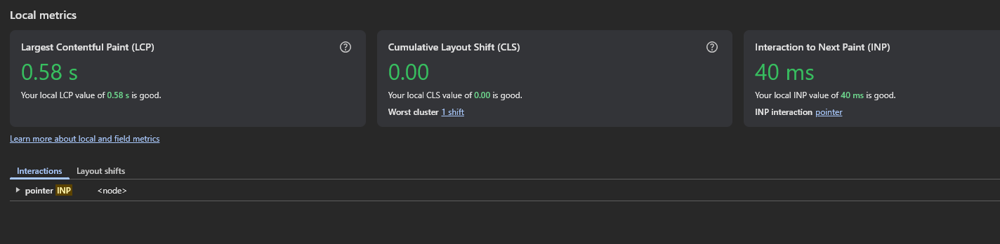
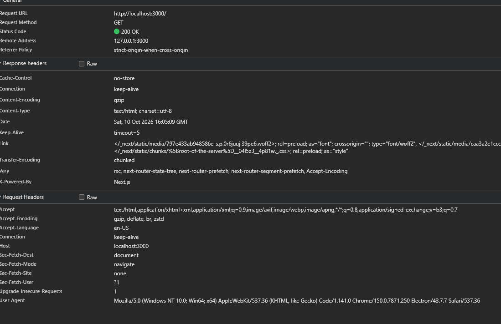

# Data and Order Lifecycle

## Menu and cart

The menu is defined in `lib/data.js`; dish IDs, prices, categories, descriptions, and local image paths are the catalog source of truth. The browser cart is client-side state and is not a durable order until checkout succeeds.

At checkout, the server action validates the submitted dish IDs and quantities against the server menu and computes prices itself. It does not trust client-submitted prices.

## Orders and persistence

`lib/db/orders.js` reads and writes order records as JSON in `.addis-eats/orders.json`. Set `ADDIS_EATS_DATA_DIR` to place that data directory elsewhere. Writes are serialized within a running Node.js process.

This file-backed store is suitable for the local demo or a single persistent Node instance, not a horizontally scaled or ephemeral production deployment. It has no cross-process transaction or distributed lock; use a shared database with transactions for multi-instance production.

Each order records its owning account ID, items, totals, delivery details, creation time, and status. Order history is filtered by the authenticated account. Order-detail rendering and the status endpoint also enforce ownership.

## Status lifecycle

The initial status is `PENDING`. Customers may cancel an order only while it is pending; a successful cancellation sets `CANCELLED`. Staff can advance an order in order through:

```text
PENDING → PREPARING → ON_THE_WAY → DELIVERED
```

Transitions are enforced in the server-side order logic, not only by the kitchen UI. The kitchen queue refreshes after a successful staff update.

The customer order-detail page polls `GET /api/orders/[id]` every five seconds for status updates. Polling stops for terminal states (`DELIVERED` and `CANCELLED`). This is periodic polling, not push-based real-time delivery. The API marks responses `Cache-Control: private, no-store` so personalized order status is not shared or reused from cache.

## Production data requirements

The JSON file is local application data, not a managed database or backup strategy. Before production, migrate orders to persistent shared storage, apply schema validation/migrations, and configure retention, access controls, and backups. Do not place the data directory in a publicly served path.


 Home landing
 menu landing
 order page
 cart page
 chekout page


